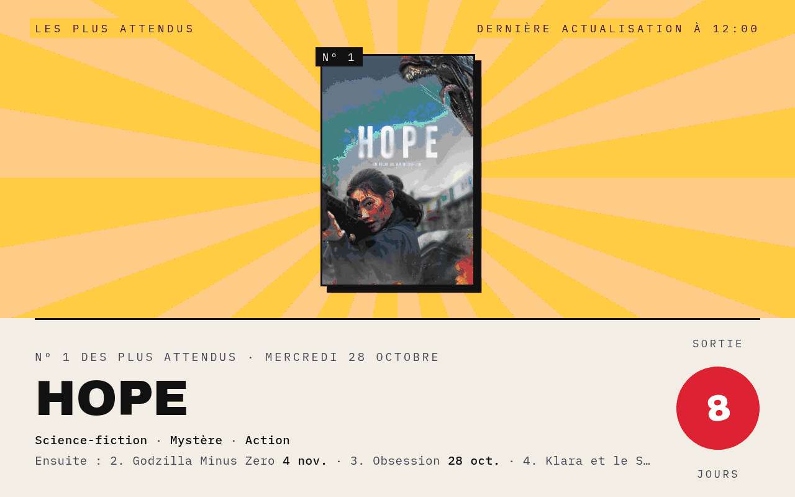
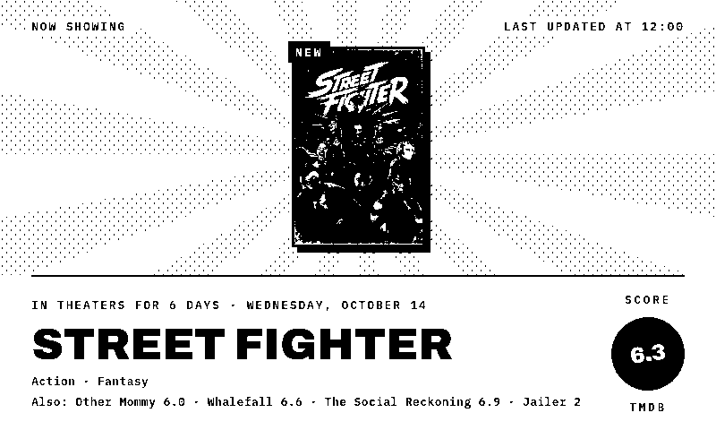
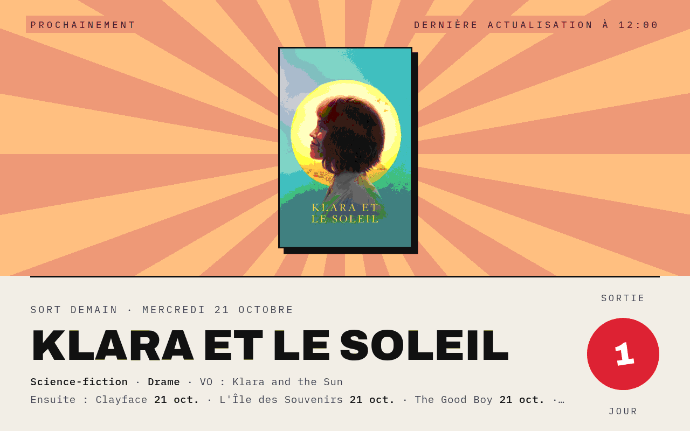
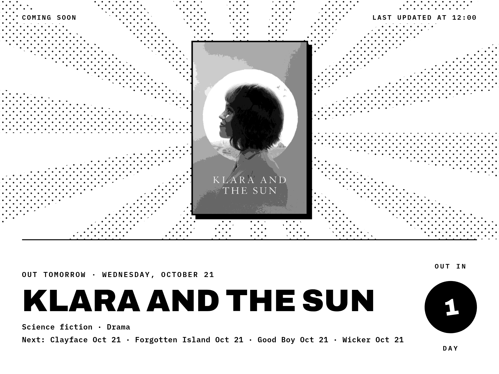
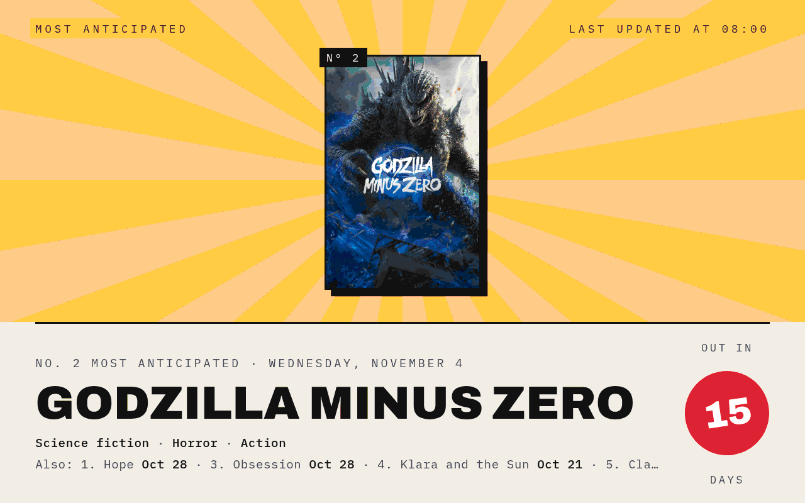
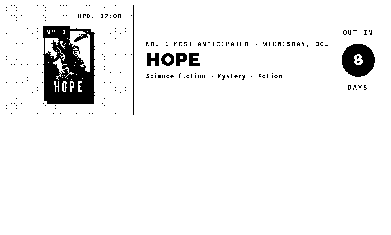
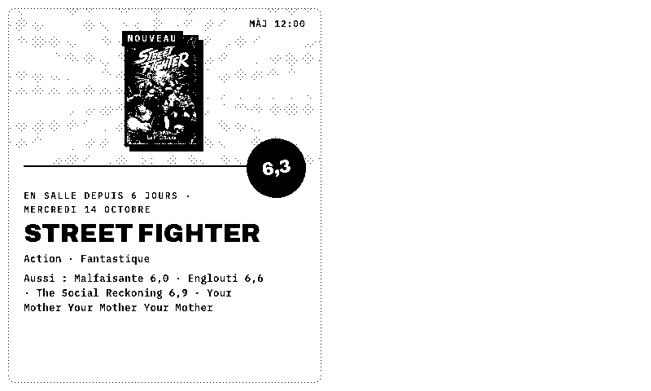
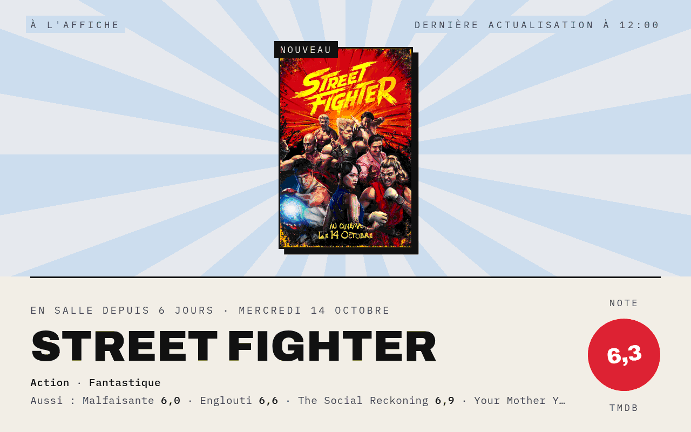
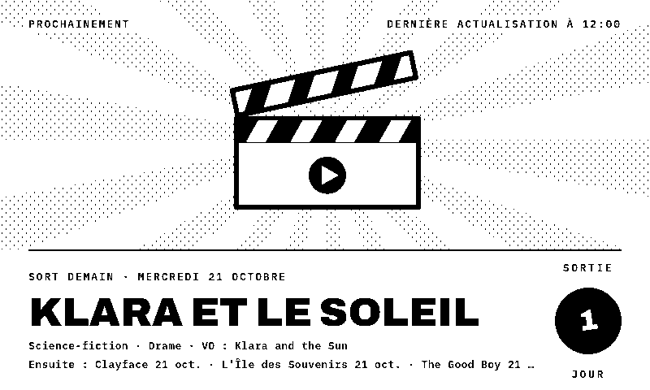
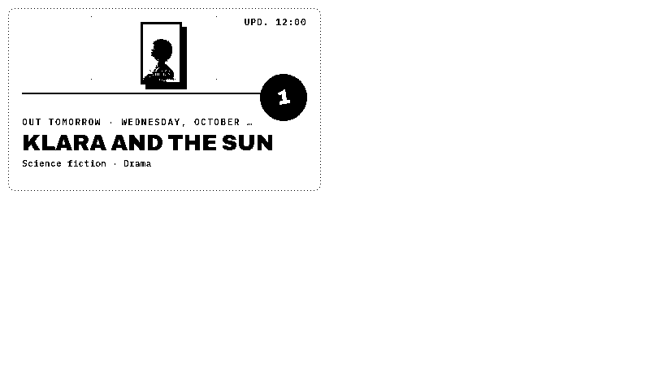

# MoviePoster

**[English](#english) · [Français](#français)**

---

## English

*What's on at the movies, drawn as a poster.*

A TRMNL plugin that puts one movie on a poster: the most anticipated upcoming movies, the ones now showing or the next releases, with its poster, its TMDB score or a countdown to its release. It is part of the Poster suite with [FlightPoster](https://github.com/BartoX360/FlightPoster), [WeatherPoster](https://github.com/BartoX360/WeatherPoster), [GamePoster](https://github.com/BartoX360/GamePoster), [ShowPoster](https://github.com/BartoX360/ShowPoster) and [BookPoster](https://github.com/BartoX360/BookPoster)and shares their look.

No server to install: the data and posters come from [TMDB](https://www.themoviedb.org), with your own free API key.

### Features

- **E-ink and color**: a pure black & white style built for 1-bit screens (TRMNL OG, TRMNL X), and a color style for LCD screens
- **Every layout**: full screen, half horizontal, half vertical and quadrant (mashups)
- **Three sections**, each with its own sky color: *Most anticipated* (gold), *Now showing* (blue), *Coming soon* (dusk)
- **Rotation**: every hour the poster moves to another section and another of its top three movies, or stays on the section you pick
- **Score stamp**: the TMDB score of a movie in theaters, or the number of days before the release
- **Your country**: release dates in theaters in France, Belgium, Switzerland, Canada, the UK or the US
- **English or French**, with the genres and the original title
- Movies without a poster get a clapperboard illustration

### Screenshots

| | |
|---|---|
|  |  |
| E-ink · now showing | Color · coming soon |
|  |  |
| TRMNL X · coming soon | Color · most anticipated |
|  |  |
| Half horizontal | Half vertical |

### Installation

First get a TMDB API key: create a free account on [themoviedb.org](https://www.themoviedb.org/signup), then *Settings → API* and copy the **API key** (v3, 32 characters).

**TRMNL (usetrmnl.com)**: create a *Private Plugin* with the *Polling* strategy, then copy:
- `polling_url` from `recipe/src/settings.yml` into *Polling URL*;
- the `custom_fields` from `recipe/src/settings.yml` into *Custom fields* (YAML);
- `recipe/src/shared.liquid` into *Shared markup*, and each `recipe/src/<layout>.liquid` into the matching layout tab.

The `recipe/src/` folder follows the [trmnlp](https://github.com/usetrmnl/trmnlp) layout.

**LaraPaper / BYOS**: *Plugins → Import recipe*, pick `movieposter-x.y.z.zip` from the [latest release](https://github.com/BartoX360/MoviePoster/releases/latest) (or zip the contents of `recipe/src/`), then fill in your settings.

### Settings

| Field | Purpose |
|---|---|
| TMDB API key | Your TMDB API key (v3) |
| Country | Release dates in theaters in this country |
| Poster | *Rotate* (every hour), or always the most anticipated movie, the most popular movie now showing or the next release |
| Language | English or French |
| Style | E-ink (black & white) or Color |

### How it works

The polling URL makes six TMDB requests, one per release week (Wednesday to Tuesday, the release day in France): last week, this week and the next four. TMDB filters on the release date in the chosen country, so each movie is dated from its local release, and re-releases of old movies are left out.

- *Now showing*: released in the last two weeks, most popular first
- *Coming soon*: the next release day, most popular first, then the following ones
- *Most anticipated*: the most popular movies coming out within four weeks

### Development

| File | Purpose |
|---|---|
| `dev/recipe_render.sh <folder>` | Zips the recipe, imports it into LaraPaper as "MoviePoster (test)", renders every test case and copies the PNGs into `<folder>`; with `TMDB_KEY` set, also checks the live feed |
| `dev/recipe_test.php` | The test cases (section, rotation, layout, device, language, missing poster, errors, missing key) run inside LaraPaper |
| `dev/test_payload.json` | Frozen TMDB results for France (October 20, 2026), in French and English, used by the test cases |
| `dev/update.php` | Copies the code of "MoviePoster (test)" into the installed plugin, keeping its settings |
| `dev/install.php` | First install: imports the recipe as "MoviePoster" with the key from `TMDB_KEY` |

The scripts target a LaraPaper server running in Docker (container `larapaper-app-1`) over SSH, set with `LARAPAPER_SSH` (e.g. `root@my-server`) in the environment or in `dev/.env` (ignored by git).

### Notes

- The screen is built with JavaScript at render time, so the renderer must run JavaScript.
- Posters are loaded from TMDB at render time; on e-ink they are turned to grayscale and dithered by the renderer.
- Titles without Latin letters (the title font has none) fall back to the original title, or the movie is skipped.
- A refresh interval of 60 minutes keeps the rotation going; TMDB's limits are far above six requests an hour.
- This product uses the TMDB API but is not endorsed or certified by TMDB.

---

## Français

*Ce qui passe au cinéma, façon affiche.*

Un plugin TRMNL qui met un film à l'affiche : les films les plus attendus, ceux qui sont en salle ou les prochaines sorties, avec son affiche, sa note TMDB ou un compte à rebours avant sa sortie. Il fait partie de la suite Poster avec [FlightPoster](https://github.com/BartoX360/FlightPoster), [WeatherPoster](https://github.com/BartoX360/WeatherPoster), [GamePoster](https://github.com/BartoX360/GamePoster), [ShowPoster](https://github.com/BartoX360/ShowPoster) et [BookPoster](https://github.com/BartoX360/BookPoster)dont il reprend le style.

Aucun serveur à installer : les données et les affiches viennent de [TMDB](https://www.themoviedb.org), avec votre propre clé d'API gratuite.

### Fonctionnalités

- **E-ink et couleur** : un style noir et blanc pur pour les écrans 1 bit (TRMNL OG, TRMNL X) et un style couleur pour les écrans LCD
- **Tous les formats** : plein écran, demi horizontal, demi vertical et quart d'écran (mashups)
- **Trois rubriques**, chacune avec sa couleur de ciel : *Les plus attendus* (doré), *À l'affiche* (bleu), *Prochainement* (crépuscule)
- **Rotation** : chaque heure, l'affiche passe à une autre rubrique et à un autre de ses trois premiers films, ou reste sur la rubrique choisie
- **Tampon** : la note TMDB d'un film en salle, ou le nombre de jours avant sa sortie
- **Votre pays** : les dates de sortie en salle en France, Belgique, Suisse, au Canada, au Royaume-Uni ou aux États-Unis
- **Français ou anglais**, avec les genres et le titre original
- Un film sans affiche est illustré par un clap

### Captures

| | |
|---|---|
|  |  |
| Couleur · à l'affiche | E-ink · film sans affiche |
|  |  |
| Quart d'écran | Demi vertical |

### Installation

Il faut d'abord une clé d'API TMDB : créez un compte gratuit sur [themoviedb.org](https://www.themoviedb.org/signup), puis *Paramètres → API* et copiez la **clé d'API** (v3, 32 caractères).

**TRMNL (usetrmnl.com)** : créez un *Private Plugin* avec la stratégie *Polling*, puis copiez :
- `polling_url` de `recipe/src/settings.yml` dans *Polling URL* ;
- les `custom_fields` de `recipe/src/settings.yml` dans *Custom fields* (YAML) ;
- `recipe/src/shared.liquid` dans *Shared markup*, et chaque `recipe/src/<format>.liquid` dans l'onglet correspondant.

**LaraPaper / BYOS** : *Plugins → Import recipe*, choisissez `movieposter-x.y.z.zip` dans la [dernière release](https://github.com/BartoX360/MoviePoster/releases/latest) (ou zippez le contenu de `recipe/src/`), puis remplissez les réglages.

### Réglages

| Champ | Rôle |
|---|---|
| Clé d'API TMDB | Votre clé d'API TMDB (v3) |
| Pays | Les dates de sortie en salle dans ce pays |
| Affiche | *Rotation* (chaque heure), ou toujours le film le plus attendu, le plus suivi à l'affiche ou la prochaine sortie |
| Langue | Français ou anglais |
| Style | E-ink (noir et blanc) ou Couleur |

### Fonctionnement

L'URL de polling fait six requêtes TMDB, une par semaine de sortie (du mercredi au mardi, le jour des sorties en France) : la semaine passée, celle en cours et les quatre suivantes. TMDB filtre sur la date de sortie dans le pays choisi : chaque film est daté de sa sortie locale, et les ressorties de vieux films sont écartées.

- *À l'affiche* : sortis ces deux dernières semaines, les plus suivis d'abord
- *Prochainement* : le prochain jour de sortie, le film le plus suivi d'abord, puis les suivants
- *Les plus attendus* : les films les plus suivis parmi ceux qui sortent d'ici quatre semaines

### Notes

- L'écran est construit en JavaScript au moment du rendu : le moteur de rendu doit exécuter le JavaScript.
- Les affiches sont chargées depuis TMDB au moment du rendu ; en e-ink, elles passent en niveaux de gris, tramés par le moteur de rendu.
- Un titre sans lettres latines (absentes de la police des titres) est remplacé par le titre original, ou le film est écarté.
- Un rafraîchissement toutes les 60 minutes suffit à faire tourner l'affiche ; les limites de TMDB sont bien au-delà de six requêtes par heure.
- Ce produit utilise l'API TMDB mais n'est ni approuvé ni certifié par TMDB.

---

## Licence / License

Code sous licence [MIT](LICENSE). Les données affichées appartiennent à leurs sources respectives. / Code released under the [MIT](LICENSE) license. The data shown belongs to its respective sources.
